  <picture>
    <source media="(prefers-color-scheme: dark)" srcset="assets/header-clear-dark.svg">
    
  </picture>

  

  
  

  
  
  
  
  
  
  
  
  

  
  
  
  
  
  
  
  
  
  

  
  
  
  
  
  
  
  
  
  
  
  

  
  
  
  

  <picture>
    <source media="(prefers-color-scheme: dark)" srcset="assets/stats-dark.svg">
    
  </picture>
  <picture>
    <source media="(prefers-color-scheme: dark)" srcset="assets/streak-dark.svg">
    
  </picture>

  <picture>
    <source media="(prefers-color-scheme: dark)" srcset="assets/contributions-dark.svg">
    
  </picture>

