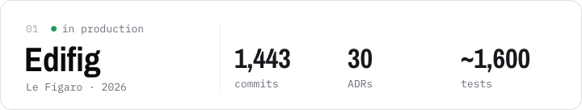
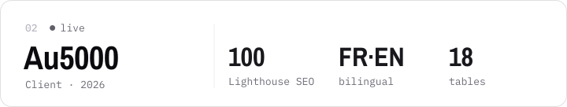
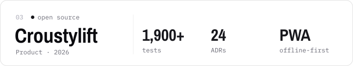
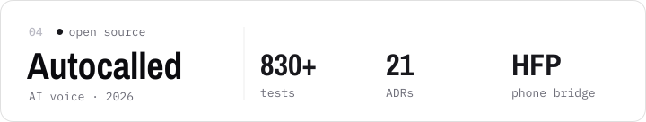
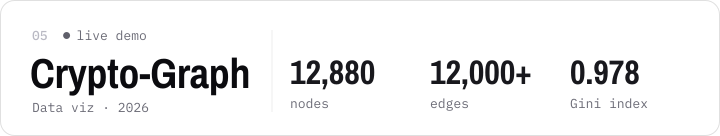

<a href="https://thibaudtl.com">
  <picture>
    <source media="(prefers-color-scheme: dark)" srcset="assets/banner-dark.svg">
    
  </picture>
</a>

I build products end to end, from the database to the last pixel, and I hand the repetitive parts to AI agents. Currently doing a Master's in MIAGE (computer science and business) at Université Paris Nanterre as a work-study student, and running my own Linux homelab on the side.

**[thibaudtl.com](https://thibaudtl.com)** · [LinkedIn](https://www.linkedin.com/in/thibaudthomaslamotte/) · [contact@thibaudtl.com](mailto:contact@thibaudtl.com)

 

## Selected work

<a href="https://thibaudtl.com/edifig">
  <picture>
    <source media="(prefers-color-scheme: dark)" srcset="assets/work-edifig-dark.svg">
    
  </picture>
</a>

A digital flatplan for the real-estate supplement of Le Figaro: an interactive grid of spreads that generates the XML for the print pipeline in real time. Built solo during my internship, graded 19/20, used by the editorial team. 
`Next.js 16` `TypeScript` `PostgreSQL` `Okta OIDC` `SSE` · **[Case study →](https://thibaudtl.com/edifig)**

 

<a href="https://au5000.com">
  <picture>
    <source media="(prefers-color-scheme: dark)" srcset="assets/work-au5000-dark.svg">
    
  </picture>
</a>

A premium bilingual website for a chalet rental with an indoor pool in Quebec, built for a client. 
`Next.js 16` `React 19` `Supabase` `Tailwind v4` `GSAP` · **[Visit →](https://au5000.com)**

 

<a href="https://github.com/Tibxla/croustylift">
  <picture>
    <source media="(prefers-color-scheme: dark)" srcset="assets/work-croustylift-dark.svg">
    
  </picture>
</a>

A local-first lifting tracker. Log a set in one tap at the gym, read your real progress later. Works offline and syncs with last-write-wins. 
`React 19` `Vite` `TypeScript` `Supabase` `Tailwind v4` · **[Code →](https://github.com/Tibxla/croustylift)**

 

<a href="https://github.com/Tibxla/autocalled">
  <picture>
    <source media="(prefers-color-scheme: dark)" srcset="assets/work-autocalled-dark.svg">
    
  </picture>
</a>

An AI voice assistant that places real sales calls through a phone on a real mobile line, books the meeting in Google Calendar, then writes a review of each call where every objection points back to the prospect's exact words. A demo project, not a commercial tool. 
`Next.js 16` `TypeScript` `PostgreSQL` `Drizzle` `ElevenLabs` `Python` `BlueZ` · **[Code →](https://github.com/Tibxla/autocalled)**

 

<a href="https://crypto-graph-explorer.vercel.app">
  <picture>
    <source media="(prefers-color-scheme: dark)" srcset="assets/work-crypto-graph-dark.svg">
    
  </picture>
</a>

An interactive D3.js map of the WETH network on Polygon during the market crash of 5 August 2024, with a university report written in LaTeX. 
`React` `TypeScript` `D3.js` `Vite` · **[Demo →](https://crypto-graph-explorer.vercel.app)** · **[Code →](https://github.com/Tibxla/crypto-graph-explorer)**

 

<b>Smaller projects</b>

 

- **[FileRenamer](https://github.com/Tibxla/FileRenamer)**, a C++/Qt desktop app that makes renamed copies of numbered files, shipped as a Windows release.
- **[SteganoPY](https://github.com/Tibxla/SteganoPY)**, a Flask app that hides any file inside a PNG image (LSB steganography).
- **[PGI-Automobile](https://github.com/Tibxla/PGI-Automobile)**, an ERP for a car dealership in plain PHP: vehicles, sales, customers, HR, stock.
- **[Maze-game](https://github.com/Tibxla/Maze-game)**, a turn-based maze in Python and Pygame: escape the Minotaur.
- **[Sorting benchmark](https://github.com/Tibxla/Comapraison-Algorithme_tri)**, 16 sorting algorithms in C, with 192 automated tests and plotted results.

## Stack

**Build** · `TypeScript` `React` `Next.js` `Astro` `Node` `Tailwind` `WebGL` `GSAP` 
**Data & ops** · `PostgreSQL` `Supabase` `Drizzle` `Docker` `GitHub Actions` `Vitest` `Claude Code` 
**Also** · `C/C++` `PHP` `Java` `Python` `LaTeX` `Tailscale`
